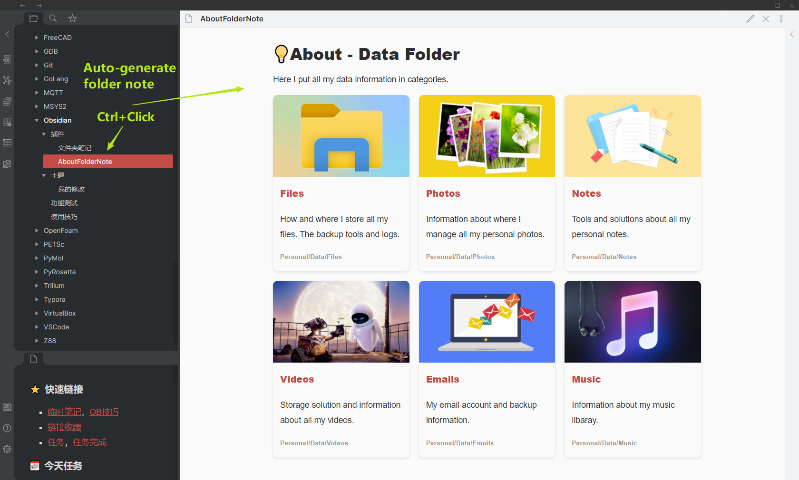
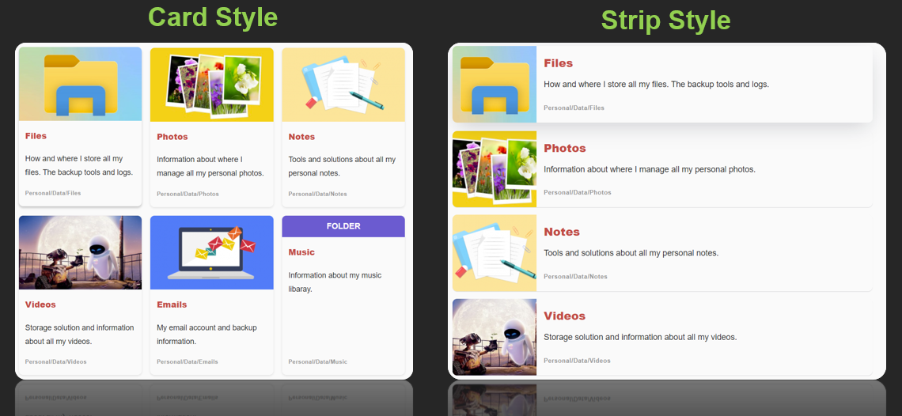

# Folder Note

An [Obsidian](https://obsidian.md) plugin that attaches a note to a folder. Click a folder to open its note, and generate card-style overviews of what's inside.

> **Fork notice:** this is a modernized fork of [xpgo/obsidian-folder-note-plugin](https://github.com/xpgo/obsidian-folder-note-plugin), which stopped working on current Obsidian versions. The update to the Obsidian 1.x API was vibe-coded with [Claude](https://claude.ai) (Anthropic). All credit goes to [xpgo](https://github.com/xpgo), who built the original plugin, and to Claude, which did the modernization. See the [change log](doc/change-log.md) for what changed.



## Usage

| Action | How |
| --- | --- |
| Create a folder note | **Ctrl+Click** a folder in the file explorer (or **Alt+Click**, see settings) |
| Open a folder note | Click the folder |
| Delete a folder note | Delete the note file |
| Turn a note into a folder | Command palette → **Make Current Note to Folder** |
| Insert a folder overview | Command palette → **Insert Folder Brief** |

## Folder note methods

Where the note file lives depends on the method you pick in settings:

| Method | Note location for folder `Projects` |
| --- | --- |
| **Inside-Folder** (default) | `Projects/Projects.md` |
| **Outside-Folder** | `Projects.md`, next to the folder |
| **Index-File** | `Projects/_about_.md` (name is configurable) |

Folder notes are hidden in the file explorer, so the folder itself acts as the note. See [Folder Note Methods](doc/folder-note-methods.md) for the trade-offs of each.

## Settings

- **Note File Method**: Inside-Folder, Outside-Folder, or Index-File.
- **Index File Name**: the note name for the Index-File method, e.g. `_about_` or `index`.
- **Initial Content**: template for new folder notes. Supported keywords:
	- `{{FOLDER_NAME}}`: the folder's name.
	- `{{FOLDER_PATH}}`: the folder's path.
	- `{{FOLDER_BRIEF}}`: a one-time `ccard` overview of the folder's contents, editable afterward.
	- `{{FOLDER_BRIEF_LIVE}}`: a `ccard` overview that updates whenever the note is rendered.
- **Key for New Note**: Ctrl+Click or Alt+Click to create a folder note.
- **Hide Folder Note**: hide folder note files in the file explorer.
- **Auto Rename**: keep folder and note names in sync when either is renamed (Inside-Folder and Outside-Folder only). Experimental.
- **Delete Folder Note**: trash the note when its folder is deleted (Outside-Folder only).

## Folder overviews (`ccard`)

The plugin renders `ccard` code blocks as card or strip views. The simplest live overview of the current folder:

````markdown
```ccard
type: folder_brief_live
```
````

You can control style, column count, image prefix, target folder, notes-only mode, brief length, and more. See [ccard Syntax](doc/ccard-syntax.md) and [ccard Recipes](doc/ccard-recipes.md).



## Install

**Manual:** download `main.js`, `manifest.json`, and `styles.css` from the [latest release](https://github.com/ShoeburR/Obsidian-Folder-Note-Plugin1.15.1/releases/latest) into `<your vault>/.obsidian/plugins/folder-note-plugin/`, then enable **Folder Note** under Settings → Community plugins.

**BRAT:** add `ShoeburR/Obsidian-Folder-Note-Plugin1.15.1` with the [BRAT](https://github.com/TfTHacker/obsidian42-brat) plugin to receive updates automatically.

> [!NOTE]
> The **Folder Note** listing in Obsidian's community plugin browser is the original, unmaintained version. Install from this repo instead.

Requires Obsidian 1.6.6 or newer.

## Build

```bash
npm install
npm run dev     # rebuild on change
npm run build   # production build
```

Pushing a version tag (e.g. `0.8.1`) runs the release workflow, which creates a draft GitHub release with the built files attached.

## Credits

- **Original plugin:** [xpgo](https://github.com/xpgo). All features and design are theirs.
- **Modernization (v0.8.0):** vibe-coded with [Claude](https://claude.ai) by Anthropic, at the request of [ShoeburR](https://github.com/ShoeburR).

If you find the plugin useful, consider supporting the original author:

[](https://www.buymeacoffee.com/xpgo)

Licensed under MIT.
